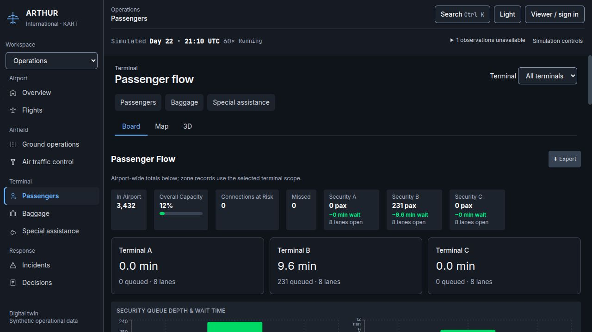
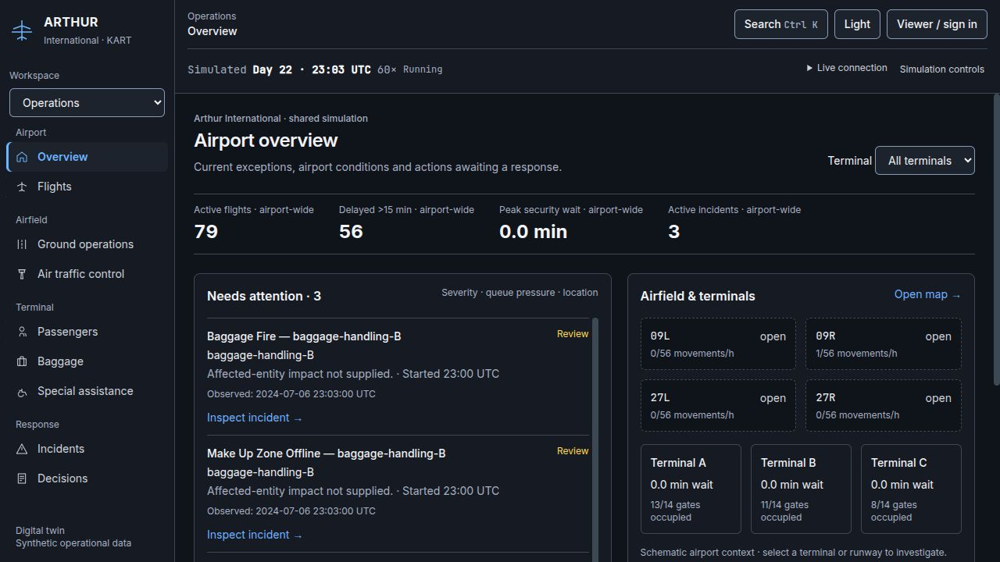

# Live airport recovery — 2026-11-16

The running `art-ldt-g6` stack was recovered in place. Neo4j volumes, entity
identities, flight history, passenger history and operator settings were preserved.
The simulation was paused during deployment and resumed at its original 60× speed.

## Root causes and repairs

1. The legacy orchestrator had no durable `SimState` and restarted from June 15,
   while persisted flights had already progressed to July 6. Existing schedules
   were correctly deduplicated, leaving the rewound day with no active flights.
   Missing checkpoints now trigger recovery from recorded actual flight times or
   owner checkpoints. Future timetables and wall time cannot move the clock.
   Startup recovered July 6 at 09:00 UTC (day 22), saved it and emitted a control
   fact. Normal subsequent restarts retain clock, pause, speed and settings.
2. Passengers stranded at gates or on aircraft had missed legacy flight events.
   Normal progression never revisited completed flights. Each tick now reconciles
   at most 2,000 passengers against persisted flight state inside the existing
   owner transaction. Domain updates, recovery facts and checkpoint commit
   together. Recovery facts carry `reconciliation_reason=persisted_flight_state`;
   they describe current disposition, without fabricating boarding history.
   Arrivals enter deplaning; diverted arrivals leave local occupancy. Future
   flight evidence cannot trigger recovery. Stale security membership is removed.
3. The flight reader excluded nonterminal flights more than 24 hours overdue.
   It now retains overdue active flights for the normal state machine, while
   bounding future schedules. No old active flights remained before July 5 after
   catch-up.
4. Incident countdowns excluded contained incidents, so runway restrictions never
   reached resolution. Timers now include contained incidents. Security congestion
   also clears on a valid, nonfrozen owner observation below 20 minutes, provided
   the observation is newer than the incident. Offset timestamps compare as UTC
   instants. Old runway incursions and congestion incidents resolved normally.
5. Density reconstruction included booked/inflight passengers, while summary
   occupancy omitted customs. Both now use one physical-presence status set.
   `passengers_today` now scopes passengers to flights on the simulated UTC day,
   rather than reporting all retained history.
6. The UI parsed bare simulator timestamps in the browser's local timezone before
   labelling them UTC. Shared UTC parsing now covers the shell, flight board,
   overview movement window, incident times and observation labels. Browser checks
   verified the deployed shell clock agrees with the owner timestamp.

## Data preservation

Before repair, the gateway reported 246,604 passengers in the airport and
1,513,034 retained passenger records. Its clock was June 19, 08:20 UTC (day 5),
while the latest actual flight evidence was July 6, 09:00 UTC.

Local recovery snapshots were saved before changing runtime state:

- `/tmp/arthur-recovery-before.json`: original settings, status and flow summary.
- `/tmp/arthur-passenger-recovery-before.csv.gz`: 316,023 affected rows with original
  passenger status, location, flight ID and flight status; 7,558,928 bytes.

The compressed row snapshot stays outside Git. No reset, volume deletion or
historical entity purge was used. Repair provenance uses the normal transactional
outbox and Kafka retention policy; this does not promise permanent Kafka replay.

## Observed recovery

| Simulated UTC time | Evidence |
|---|---|
| July 6, 09:00 | Recovered clock; paused for verification, then resumed at 60× |
| July 6, 12:16 | 128 of today's 420 flights completed/arrived; aircraft in approach, taxi, boarding and airborne states |
| July 6, 13:24 | 179,890 stranded at-gate passengers remained; bounded recovery ongoing; passenger outbox empty |
| July 6, 15:13 | 124,303 stranded at-gate passengers remained; no old active flights before July 5 |
| July 6, 18:30 | Orchestrator recreated; restored this durable clock and resumed automatically, with prior settings |
| July 6, 20:12 | 4,361 physical passengers; 320 flights arrived/completed, 69 airborne, 11 boarding; today's passenger count 68,031 |
| July 6, 21:05 | Browser showed 3,479 passengers, 13% capacity and an operating security queue; screenshot below |
| July 6, 21:37 | Zero passengers stranded on completed departures scheduled before July 6; all 55 historical runway-incursion/security-congestion incidents resolved |
| July 6, 22:42 | 772 physical passengers; 66 flight IDs changed status since the 20:12 sample |
| July 6, 23:31 | Next day seeded automatically: 420 flights with 420 distinct IDs and 65,817 linked passengers; passenger outbox empty |

Counts above are observations at distinct times, not an atomic cross-service
snapshot. Normal live queue pressure and new incidents can still occur.

## Validation

- 56 focused recovery, owner transaction, timestamp and readiness tests passed.
- 178 flight/passenger state-machine, runway, security and incident regression
  tests passed (one readiness test overlaps the focused run).
- 28 passenger/flight outbox and incident ownership tests passed.
- Dashboard: 111 tests passed in 24 files under `TZ=Europe/Luxembourg`, including
  bare UTC strings, explicit offsets and invalid-clock rendering.
- Guarded serial Docker builds completed for the four repaired owners and the
  dashboard; production TypeScript/Vite build completed in the dashboard image.
- Existing baggage queues were checked: queued bags belonged to current scheduled
  or boarding departures, rather than the historical finished-flight cohort.
- Disk guard retained a 20 GiB minimum; host free space after builds was 90 GiB.
  No images or volumes were pruned.

Gateway samples with aggregate counts: [live-samples.json](live-samples.json).

